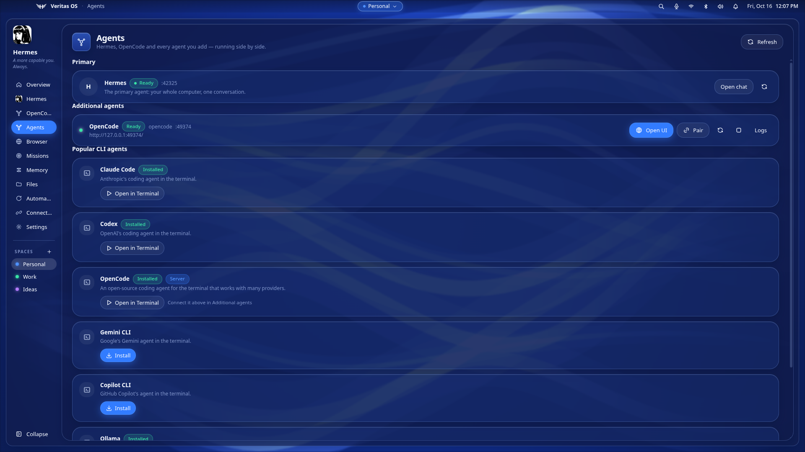
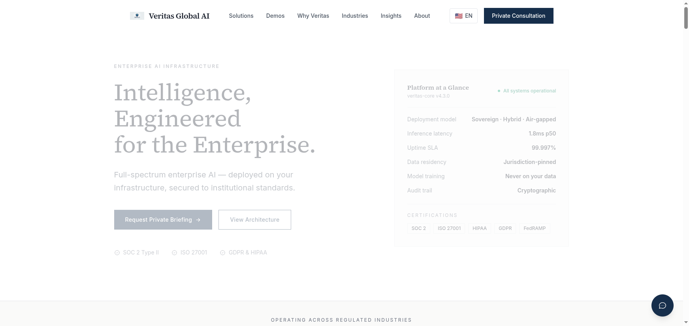
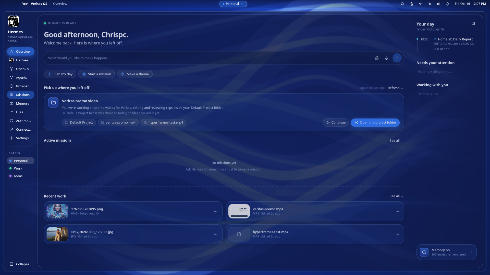
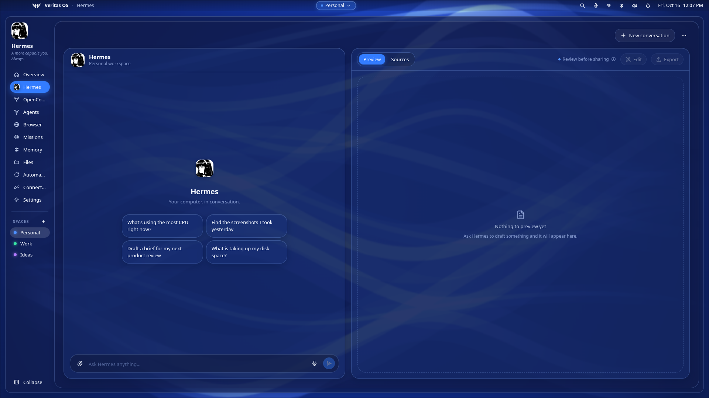
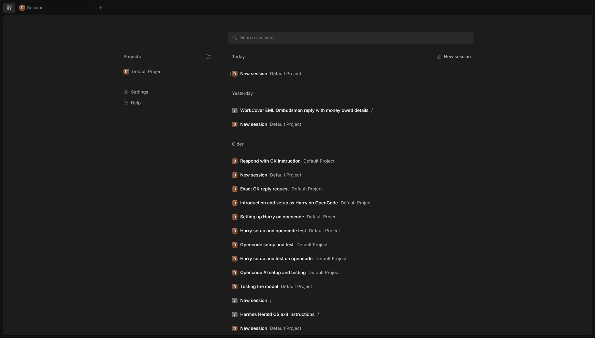
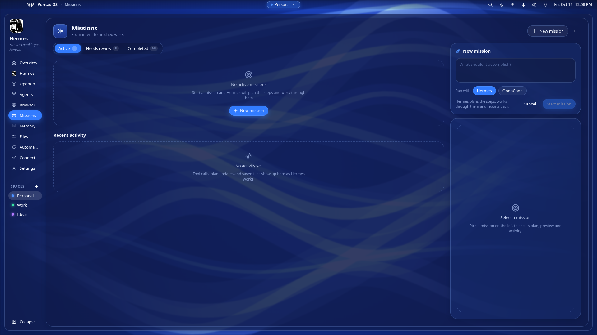
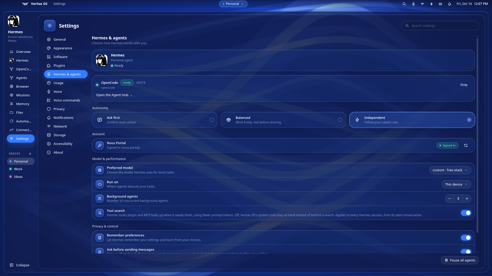

# Veritas OS

**An agent-native desktop shell — a multi-agent fork of Herald OS that turns "one agent" into a control room for all of them.**

Veritas OS is a full desktop environment built around AI agents. It looks and works like a small operating system — dock, windows, spaces, files, canvas, capture, terminal — but the centre of gravity is a **multi-agent hub**: run Hermes, OpenCode, and any other CLI coding agent you install, side by side, and **control and monitor every one of them from the same shell**.

> **Fork note.** This project began as a fork of **Herald OS** (`@herald-os/desktop`, MIT, by Luke The Dev), an agent-native shell built around a single agent (Hermes). We kept everything that makes it excellent — the shell, the windows, the native web-view layer, the IPC design, the theme system, the plugin host — and rebuilt the agent layer around one idea: **there is never just one agent.** Herald OS is the foundation; the multi-agent layer, the browser, and the "connect any agent" model are ours.

<!-- Hero -->


---

## Why fork it?

Herald OS hard-codes a single backend: it spawns `hermes serve` and the whole UI assumes Hermes is the only agent. That is a great shell with one resident.

Veritas OS generalises that into an **Agent Manager**:

- **Several agents at once**, each its own process with its own token, ready-detection, log tail and restart backoff.
- **OpenCode built in** — it attaches to OpenCode's own shared background service, so its sessions, models and pairing are the *same world* as your CLI.
- **Any agent you want** — drop a small JSON spec in `~/.config/veritas-os/agents.json` and it appears in the sidebar, the hub, and the mission picker.
- **One place to run them all** — start, stop, restart, read logs, pair a device, hand a mission to the agent you choose.

## Features

### Multi-agent, first-class
| | |
|---|---|
| **Agent Hub** | Every agent as a live card: phase, port, start/stop/restart, log tail, pair. |
| **Agents in the sidebar** | Connected agents — and terminal agents you've opened — sit **with** Hermes at the top; click one and it takes over the page, exactly like Hermes does. |
| **Embedded agent UIs** | Agents that ship a web UI (OpenCode) are rendered *inside* the shell in a native view; CLI agents (Copilot, Claude Code, …) get an embedded terminal page — no browser, no second window. |
| **Hermes, native** | Hermes keeps its first-class surface: JSON-RPC chat, streaming replies, sessions, tools, approvals. |
| **Pairing** | One-click `opencode pair` — a real, validating one-time link, generated against the agent's own service. |
| **Popular CLI agents** | A catalog of the well-known terminal agents (Claude Code, Codex, OpenCode, Gemini CLI, Copilot CLI, …) — install, then open as an embedded terminal page pinned in the sidebar. |
| **Missions on any agent** | "New mission" asks *which agent* should run it. Hermes plans a todo list and works through it; other agents take the goal as a prompt. |

### A real shell (inherited, and it is good)
- **Windows, dock, spaces** — a window manager with minimise/maximise, snapping, a live dock, and named spaces for different kinds of work.
- **Files** — browse, search, thumbnails, reveal, trash, drag into the agent.
- **Canvas** — a layered image editor with PSD support, AI generative fill and background selection, driven by the agent.
- **Capture** — screenshot region/window/screen, markup editor, screen recording with a camera bubble.
- **Terminal** — a real PTY terminal (`node-pty`) with tabs; coding agents open as their own embedded terminal page.
- **Automations** — event- and schedule-driven routines the agent can run.
- **Memory & Missions** — what the agent knows, and long-running work with a plan and a review step.
- **Connections** — MCP servers, messaging platforms, toolsets and provider sign-in, all discovered and probed live.
- **Themes** — built-in *Veritas* themes (Dusk, Cloud, Ember, Forest, Graphite, Ice, Lagoon, Ocean, Onyx, Paper, Rose, Violet), plus themes made from an image.
- **Plugins** — a widget plugin host (install from git, enable/disable, panels or floating widgets).
- **Voice** — dictation and spoken replies.

### The browser
- **Inline Chromium page** — a real browsing surface inside the shell (address bar, go, reload).
- **BrowserOS integration** — Veritas OS detects your [BrowserOS](https://browseros.com) install, shows its state, starts it when it is not running, lists its tabs, and hands any page to it with **Open in BrowserOS**.



---

## Screenshots

**Overview — your day, already in motion**



**Hermes — the native agent surface**



**OpenCode — an agent's own UI, embedded in the shell**



**Missions — choose which agent runs the mission**



**Settings — agents, models, voice, privacy, themes**



---

## Adding your own agent

Any local process with an HTTP health endpoint can be an agent. `~/.config/veritas-os/agents.json`:

```json
[
  {
    "id": "my-agent",
    "name": "My Agent",
    "kind": "generic",
    "command": ["my-agent", "serve", "--port", "{port}"],
    "env": { "MY_AGENT_HOME": "~/.my-agent" },
    "readyUrl": "http://127.0.0.1:{port}/health",
    "embedUrl": "http://127.0.0.1:{port}/",
    "pairCommand": ["my-agent", "pair"],
    "runCommand": ["my-agent", "run", "{goal}"],
    "defaultEnabled": true
  }
]
```

| Field | What it does |
|---|---|
| `command` | argv to spawn. `{port}` is a free port chosen for you. |
| `readyUrl` | Polled until it answers with a sub-400 status; that is "ready". |
| `embedUrl` | If the agent has a web UI, it is embedded in a native view on its page. |
| `attach` | `opencode-service` attaches to a shared service instead of spawning a private one. |
| `pairCommand` | Prints one-time pairing links; the Pair button runs it and shows the link. |
| `runCommand` | How the agent runs a mission; `{goal}` is the mission text. |

Agents registered this way automatically get: a **sidebar entry**, an **Agent Hub card**, a **Pair** button (if they support it), and a **slot in the mission picker** (if they can run one).

---

## Install & run

**Requirements:** Node ≥ 22, Linux (Wayland/X11), Electron 44.

```bash
git clone https://github.com/<you>/veritas-os
cd veritas-os
npm install            # Electron + React + Vite + esbuild
npm run build          # main + preload (esbuild) and renderer (Vite)
npm start              # launch
```

The shell starts its agents automatically: the **Hermes** backend (if installed) and **OpenCode** (attached to its shared service). Stop and start any of them from the Agent Hub.

### Desktop entry

`~/.local/share/applications/veritas-os.desktop` → runs `start.sh`, so it launches from your app launcher like any other app.

### Linux CLI

On Linux, the catalog, installs, themes and keymap are driven by the `herald-os` CLI that ships in `linux/bin/`. Put them on your PATH so the shell finds them:

```bash
for f in linux/bin/*; do ln -sf "$(pwd)/$f" ~/.local/bin/$(basename "$f"); done
```

## Architecture

```
electron/
  main.ts                 app entry, windows, IPC registration
  agents/manager.ts       the multi-agent manager: spawn, ready, restart, pair, run
  agents/ipc.ts           agent channels + state broadcast
  browseros.ts            BrowserOS discovery, launch, CDP control
  ipc/                    fs, capture, terminal, web (native views), theme, voice, …
  backend/manager.ts      the primary Hermes backend (kept from Herald OS)
  plugins/                the widget plugin host
shared/ipc.ts             the typed IPC contract shared by main and renderer
preload/index.ts          window.heraldOS — the context bridge
src/                      the React shell: sidebar, dock, windows, features/*
  features/agents/        Agent Hub, agent pages (web + embedded terminal), popular-agents catalog
  features/browser/       the inline browser
  features/missions/      mission composer with the agent picker
resources/                catalog, themes, the hermes bridge plugin
linux/                    the Linux CLI (herald-os): catalog, install, theme, keymap, idle
public/brand/             brand images (resolved at runtime — see notes)
```

**Design notes worth stealing**

- **The main process owns the secrets.** Agent tokens never reach the renderer; REST and RPC are proxied.
- **Native views for web UIs.** Agents' web UIs are `WebContentsView`s layered over the window; the renderer streams the content rect, and the view is **hidden the moment its page is not active** (a native layer ignores DOM visibility — this was the bug that made every page look like it was stuck on one agent).
- **One service per agent ecosystem.** Attaching to OpenCode's shared background service instead of spawning a private server is what makes pairing links, sessions and the embedded UI agree.

---

## Credits

- ****Herald OS**** — the shell this is forked from (MIT, Luke The Dev). The window manager, dock, files, canvas, capture, terminal, plugins, themes and the native-view architecture are theirs.
- **[Hermes Agent](https://hermes-agent.nousresearch.com/)** — the primary agent runtime.
- **[OpenCode](https://opencode.ai)** — the second built-in agent and its web UI.
- **[BrowserOS](https://browseros.com)** — the AI browser Veritas OS hands pages to.

## License

MIT — see [LICENSE](LICENSE).
